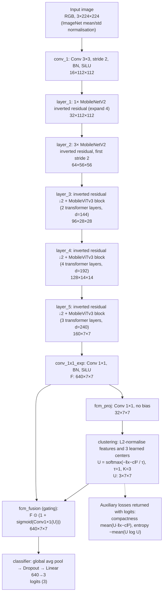

# P0.3 — Implementation-faithful architecture spec: MobileFCMViTv3

Owner: John Dalton Gibson · 2026-10-19 · Depends on: P0.1

This document describes the model **as the code builds it and as the trained checkpoints
contain it**. It was not drawn from the paper or from the old Fig. 1. Every value below
comes from a source file or from `architecture_trace.json`, which
`scripts/trace_architecture.py` produced in a clean `git archive` export of commit
`c084eb8`.

## 1. Verdict

| Question | Answer | Evidence |
|---|---|---|
| Input channels | **3** (RGB). A 4-channel input is rejected. | Stem weight `[16, 3, 3, 3]` in every checkpoint; 4-ch forward raises a shape error (trace JSON `input_contract`). |
| FCM type in MobileFCMViTv3 | **Differentiable feature-space soft clustering only.** No pixel-space FCM map enters the model. | `models/soft_clustering.py`; `utils/dataset.py` returns RGB only; nothing in `mobilefcmvitv3/` imports `fcm/`. |
| Where pixel-space FCM is used | Only in the **MambaVision baseline** (`baseline/mambavision_fcm/`), as a precomputed 4th input channel, when `--fcm_dir` is set. | `utils/imagefolder_with_fcm.py`; `models/mambavision_fcm_net.py` (`in_chans=4`); 780 PNG maps in `baseline/mambavision_fcm/fcm/`. |
| Fusion operation | **Multiplicative channel gating** (`fusion_type: attention`), not concatenation. | `fcm_fusion.proj.weight [640, 3, 1, 1]` in the checkpoints; concat fusion would contain `fcm_fusion.conv.*`. |
| Classifier head | GAP → Dropout → **Linear(640→3)**. No Dense(1024)/ReLU layer; softmax is not part of the model. | `classifier.3.weight [3, 640]`. |
| Parameters | **3,712,323** (3.712 M). The FCM path adds 23,136 (0.62 %). | Trace JSON `parameters`. |
| Compute at 224×224 | **2.26 GFLOPs** (1.13 GMACs). The repo's "1.176 G" is a `thop` MAC-style count logged as "FLOPs". | Trace JSON `compute_224`. |
| Is the clustering doing anything in the trained model? | **No.** The three learned centers point in the same direction (cosine ≥ 0.999998). Memberships equal 1/3 to within 2×10⁻⁵ on real images, so the fusion reduces to a fixed per-channel gain. | Trace JSON `trained_cluster_behaviour` (headline checkpoint, 24 validation images). |
| Same code then and now? | **Yes.** The model files are byte-identical in the April commits `1dbf997`/`e19e9fa` (old repo) and `5158ed1`; HEAD differs only by moving the config dict. All checkpoints load into HEAD with `strict=True`. | Section 6. |
| Clean checkout instantiates the documented model? | **Yes.** | Section 6. |

## 2. Architecture diagram (from the verified forward pass)

Shapes are for one 224×224 image. All convolution blocks are Conv → BatchNorm → SiLU
unless marked otherwise.



The FCM path is **sequential, after the whole backbone**. It does not branch in parallel
from an intermediate MobileViTv3 block.

## 3. Forward pass with tensor shapes

From forward hooks on the headline checkpoint. Source: `models/mobilefcmvitv3_net.py`,
`forward()`.

| Step | Module | Type | Output shape | Params |
|---|---|---|---|---|
| 0 | input | — | 1×3×224×224 | — |
| 1 | `conv_1` | ConvLayer 3×3 s2 + BN + SiLU | 1×16×112×112 | 464 |
| 2 | `layer_1` | 1× InvertedResidual | 1×32×112×112 | 3,968 |
| 3 | `layer_2` | 3× InvertedResidual | 1×64×56×56 | 86,528 |
| 4 | `layer_3` | IR ↓2 + MobileViTv3Block (2 tr. layers, d=144, 9 heads) | 1×96×28×28 | 431,984 |
| 5 | `layer_4` | IR ↓2 + MobileViTv3Block (4 tr. layers, d=192, 6 heads) | 1×128×14×14 | 1,371,968 |
| 6 | `layer_5` | IR ↓2 + MobileViTv3Block (3 tr. layers, d=240, 15 heads) | 1×160×7×7 | 1,688,672 |
| 7 | `conv_1x1_exp` | ConvLayer 1×1 + BN + SiLU | 1×640×7×7 (= **F**) | 103,680 |
| 8 | `fcm_proj` | Conv2d 1×1, no bias | 1×32×7×7 | 20,480 |
| 9 | `clustering` | SoftClusteringLayer | U: 1×3×7×7; two scalar losses | 96 (centers 3×32) |
| 10 | `fcm_fusion` | AttentionFusion | 1×640×7×7 | 2,560 |
| 11 | `classifier` | AdaptiveAvgPool2d → Flatten → Dropout → Linear | 1×3 | 1,923 |
| | **Total** | | | **3,712,323** |

The model returns `(logits, compactness_loss, entropy_loss)`.

**MobileViTv3 block** (`models/mobilevitv3_block.py`):
1. Local representation: depthwise 3×3 conv (BN, SiLU), then pointwise 1×1 to the
   transformer width d.
2. Unfold into 2×2 patches and apply N pre-norm transformer layers (MHA + FFN), then
   LayerNorm.
3. Fold back; project d → C with a 1×1 conv (BN, SiLU).
4. **Fuse**: concatenate the local and global features and apply a 1×1 conv (BN, SiLU).
5. Add the block input (residual).

Layer names match the official cvnets MobileViTv3-S checkpoint, so its pretrained weights
load directly.

## 4. FCM module as implemented

Source: `models/soft_clustering.py`, `models/mobilefcmvitv3_net.py`.

For every spatial position j of the projected feature map (49 positions at 7×7):

- x̂ⱼ = xⱼ / ‖xⱼ‖ and ĉₖ = cₖ / ‖cₖ‖ (`normalize_feat: true`), with k = 1..K and K = 3
  learned centers.
- dⱼₖ = ‖x̂ⱼ − ĉₖ‖², which lies in [0, 4] after normalisation.
- uⱼₖ = softmax over k of (−dⱼₖ / τ), with τ = 1 (`membership: softmax`).
- An alternative `membership: fcm` mode, uⱼₖ = 1 / Σₗ (dⱼₖ/dⱼₗ)^(2/(m−1)), exists but was
  **not used** by any headline-lineage run. `fcm_m = 2` is therefore inactive.
- Fusion: F′ = F ⊙ (1 + σ(W U + b)), with W ∈ ℝ^{640×3} and b ∈ ℝ^{640}, both
  zero-initialised.
- Losses: L = CE + λ_c · mean(U · d) + λ_e · (−mean(U log U)).
  - Headline lineage: λ_c = 0.01 for tune_05 and 0.1 for the epoch-0 headline run;
    λ_e = 0 for both.

**Behaviour of the trained weights.** With the centers collapsed to one direction, all dⱼₖ
are equal for each j. Then U = 1/3 everywhere, W U + b is the same constant vector for every
image and position, and the fusion is a **fixed learned per-channel scale** of F. The
clustering contributes no image-dependent information to the prediction. The logged
`train_entropy_loss` = 0.366204… = ln(3)/3 in every run is the same symptom. Likely cause:
compactness pulls the centers toward the mean feature direction, and with λ_e = 0 nothing
pushes them apart. Fixing this belongs to P2.2/P2.3.

### Other FCM-named code (not part of MobileFCMViTv3)

| Code | What it is | Used by |
|---|---|---|
| `fcm/fuzzy_cmeans.py`, `fcm/precompute.py` | Classical NumPy FCM on raw pixel intensities; writes lesion-map PNGs. | **No training script imports it.** |
| `baseline/mambavision_fcm/precompute_fcm.py` + `utils/imagefolder_with_fcm.py` | Pixel-space FCM map concatenated as a 4th input channel. The 4th stem channel is initialised as the mean of the pretrained RGB filters. | MambaVision-FCM baseline runs with `--fcm_dir` (W&B runs `mobilefcmvit2_net_BUSI`, 36.8 M params). |
| `mobilefcmvitv3/models/fcm_only.py` (`FCMOnlyNet`) | Flattens the RGB image, applies Linear(150528→32), soft-assigns to 3 prototypes, then Linear(3→3). Image-level, not a pixel map. Its membership exponent is 1/(m−1) on non-squared distances, not the textbook FCM exponent. | FCM-only ablation (first run 2026-07; no April run exists). |

## 5. FCM type per experiment

| Experiment | Model | FCM used | Input |
|---|---|---|---|
| Headline (paper Table 2 "ours", Tables 3–4, Fig. 2) | MobileFCMViTv3 | Feature-space soft clustering (collapsed) | 3-ch RGB |
| tune_01 … tune_11, k-fold, seeds | MobileFCMViTv3 | Feature-space | 3-ch RGB |
| Ablation `full_fcm_*` | MobileFCMViTv3 | Feature-space | 3-ch RGB |
| Ablation `no_fcm_*` | MobileFCMViTv3, same architecture | Module present; only λ_c set to 0 | 3-ch RGB |
| Ablation `mobilevitv3_only` | MobileViTv3OnlyNet | None | 3-ch RGB |
| Ablation `fcm_only` | FCMOnlyNet | Image-level prototype assignment | 3-ch RGB, flattened |
| MambaVision-FCM baseline (`mobilefcmvit2_net_BUSI`) | MambaVisionFCM | **Pixel-space precomputed map** | **4-ch** |
| Paper rows "UltraScanNet" / "Mamba Vision" | Baselines from `extended_metrics.txt` | Not determinable from that file (no command or config per row) | Unknown → P0.4 |

**No experiment combines both FCM types.**

## 6. Clean-checkout reproduction

To reproduce:

```bash
mkdir /tmp/p03 && git archive c084eb8 | tar -x -C /tmp/p03
cp audit/P0.3/scripts/trace_architecture.py /tmp/p03/audit/P0.3/scripts/   # if not yet committed
cd /tmp/p03 && CUDA_VISIBLE_DEVICES="" <repo>/.venv/bin/python audit/P0.3/scripts/trace_architecture.py \
  --config tuning/tune_05_augmix.yaml \
  --checkpoint <repo>/checkpoints/mobilefcmvitv3_s_BUSI/model_best.pth.tar \
  --extra_checkpoints <repo>/tuning/tune_05_augmix_oldsplit/checkpoints/model_best.pth.tar \
      <repo>/tuning/tune_05_augmix/checkpoints/model_best.pth.tar \
      <repo>/ablation_results/mobilefcmvitv3_full_fcm_pretrained/checkpoints/model_best.pth.tar \
  --images <repo>/datasets/BUSI_split/validation --n_images 24 \
  --out audit/P0.3/architecture_trace.json
```

Environment: torch 2.13.0+cu129, CPU-only; see `audit/P0.1/environment.txt`.

Checkpoints loaded with `strict=True` (raw and EMA weights all succeeded):

| Checkpoint | SHA-256 (prefix) | Saved epoch | Stored top-1 | What it is |
|---|---|---|---|---|
| `checkpoints/mobilefcmvitv3_s_BUSI/model_best.pth.tar` | `e038339e` | 0 | 92.95 | **Headline checkpoint**: April tune_05 fine-tuned for one epoch; source of Fig. 2. |
| `tuning/tune_05_augmix_oldsplit/checkpoints/model_best.pth.tar` | in P0.1 inventory | 65 | 92.95 | **April tune_05**, the weights the headline run started from. Written 2026-04-25 10:12 UTC, later moved to `_oldsplit`. |
| `tuning/tune_05_augmix/checkpoints/model_best.pth.tar` | `25ecafc9` | 23 | 89.57 | **July 2026 retrain** on the v2 split. Not the April model, despite the path the April config names. |
| `ablation_results/mobilefcmvitv3_full_fcm_pretrained/checkpoints/model_best.pth.tar` | in P0.1 inventory | 221 | 86.96 | July ablation. |

**Code identity.** `models/mobilefcmvitv3_net.py`, `soft_clustering.py`,
`mobilevitv3_block.py` and `utils/dataset.py` are byte-identical between the April commits
(`1dbf997`, `e19e9fa`, recovered from the old repo `DeepCoaches-CMU/ultrascannet_reproduced`)
and this repo's first commit `5158ed1`. `utils/augmentation.py` differs only by an added TTA
helper that training doesn't call. Since then, the model change is a config-dict move
(`5158ed1` → HEAD), which strict loading confirms is shape-preserving.

## 7. Implementation details that matter for later tasks

1. **`drop_path_rate` does nothing.** `MobileFCMViTv3.__init__` accepts it but never uses
   it, so every config's `drop_path_rate` (0.1/0.2) has no effect. This is the same class
   of bug as the old dead `vflip`.
2. **One `dropout` knob drives two things:** the classifier dropout and the transformer
   projection/attention-output dropout. The headline run used `dropout: 0.2`; tune_05 used
   0.1.
3. **Raw-vs-EMA selection on validation.** Each epoch, `train.py` evaluates both the raw
   weights and the EMA weights and keeps whichever scores higher on validation. That is one
   more selection step on the validation set (relevant to P0.4/P1.3).
4. **Non-strict loading in `test.py`.** It loads checkpoints with `strict=False` (EMA by
   default), so a mismatched checkpoint would load partially without error. P1.2 should
   switch it to strict.
5. **Compute is undercounted and mislabelled.** `utils/metrics.compute_efficiency` uses
   `thop`, which reports MACs and skips functional ops such as the attention matrix
   multiplications. Report **2.26 GFLOPs / 1.13 GMACs**, or state the convention.
6. **`load_pretrained` hides mismatches.** It skips tensors whose shapes don't match,
   without error, and loads only `state_dict` (raw weights, not EMA) from a warm-start
   checkpoint.
7. **Export and deployment.** `export_quantize_model/`:
   - writes ONNX and TorchScript; there is no TFLite path;
   - its quantisation uses `fbgemm` (x86 server backend), and no quantised artifact exists;
   - its config points at `tuning/tune_05_augmix/...`, which held different weights at
     different dates, so which weights the ONNX contains is unresolved (→ P0.4/P3);
   - there is no Flutter/Android app code in the repository.
8. **Preprocessing as implemented.**
   - Training: RandomResizedCrop (bicubic), horizontal/vertical flips, brightness/contrast
     jitter, ToTensor, ImageNet RGB normalisation.
   - Validation/test: Resize(256, bicubic) → CenterCrop(224) → ImageNet normalisation.
   - Images are read as RGB; grayscale ultrasound PNGs have R = G = B.
   - **The April (headline) runs differed:** `vflip` was silently ignored and ColorJitter
     also applied saturation (fixed in `b78bbef`, 2026-09).

## 8. Paper claims that must change

The full claim-by-claim table is in `claims_vs_code.csv`. The main corrections:

- **§Abstract, Contribution (1), §3.3, Conclusion.** "FCM soft lesion cluster map as a
  fourth input channel" → the model takes 3-channel RGB. FCM is a learned clustering layer
  on the final 7×7 feature map, merged back by channel gating. Remove the 4-channel input
  tensor, the "computed per image after the split" step and the "channel-extension
  strategy". Those describe the MambaVision baseline code, not this model.
- **"Lesion probability map" / "lesion cluster map" / "spatial prior" / "highlights tissue
  boundaries".** Unsupported. Memberships are over learned feature clusters with no lesion
  semantics, and in the trained model they are uniform (see Section 4).
- **§3.1 and Fig. 1.**
  - Fig. 1 omits the stem's two MobileNetV2 stages.
  - The FCM path does not branch from the third block; it follows `conv_1x1_exp`.
  - Fusion is gating, not concatenation.
  - The 1×1 conv comes *before* clustering, not after fusion.
  - The head is GAP → Dropout → Linear(640→3), not Dense(1024)/ReLU/Dropout(0.1)/Dense(3).
  - Replace Fig. 1 with Section 2's diagram.
- **§3.1 "exports the quantised model to TFLite"; "Flutter-based Android application".**
  Not in the repository. Narrow these claims or supply the code (P3.2).
- **§3.2 six-step preprocessing and 1.59 s.** Not implemented. Replace with Section 7,
  item 8, or add and evaluate that pipeline.
- **"1.176 GFLOPs".** Either "1.13 GMACs (2.26 GFLOPs)" with the counting tool named, or
  the thop figure labelled as MACs.
- **3.712 M parameters.** Matches the code; keep it.
